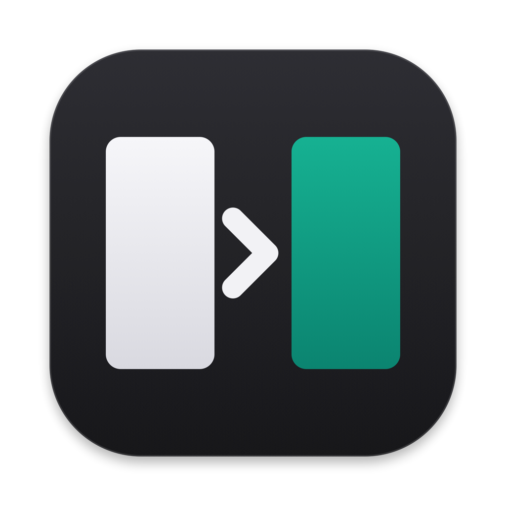
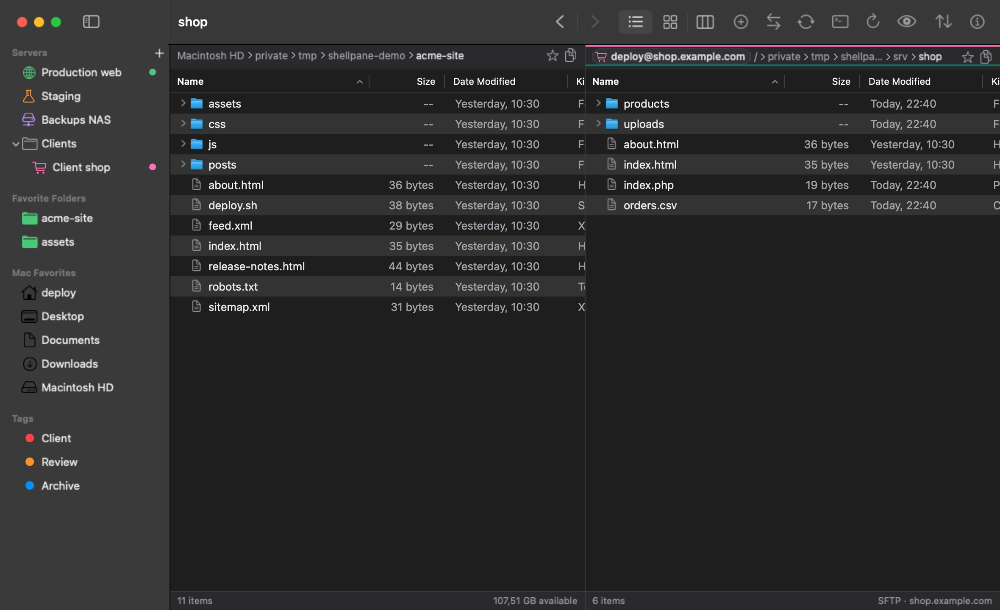

<p align="center">
  
</p>

<h1 align="center">Shellpane</h1>

<p align="center">
  <a href="LICENSE"></a>
  
  
  
</p>

**The Mac file manager for people who live in SSH.** Two panes, your Mac on one side and your servers on the
other. If `ssh yourserver` works in Terminal, it works in Shellpane: it runs your Mac's own `/usr/bin/ssh`,
so your `~/.ssh/config`, keys, agent (1Password, Secretive…), jump hosts and `known_hosts` just work.



**[Download for Mac](https://github.com/tfcoelho/shellpane/releases/latest/download/Shellpane.dmg)** ·
[Website](https://tfcoelho.github.io/shellpane/) · free and open source (MIT) · macOS 14 or later, Apple silicon and Intel

> **First launch:** Shellpane isn't notarised by Apple yet, so macOS asks the first time. Click **Done**, then
> **System Settings › Privacy & Security › Open Anyway**. Once. Or build it yourself (below).

## What it does

- **Your ssh, not a copy of it.** `Include`, `Match`, `ProxyJump`, `IdentityFile`, agents and passphrase keys
  behave exactly as in Terminal. Opened from the Dock, it still reads `SSH_AUTH_SOCK` from your login shell.
- **An organised sidebar.** Servers with their own icon and colour, in groups; favourite folders, on your Mac
  or on a server; your Finder Favorites and tags.
- **Keyboard first.** Space marks files, F5 copies to the other pane, F6 moves, F4 edits on the server, `/`
  filters, → and ← open folders in place, ⌘L types a path.
- **Errors you can act on.** ssh's own words, plus a button that copies the same login as `ssh -v`.
- **Safe by default.** A changed host key is a hard stop. Passwords live in your Keychain.
- **And the rest:** tabs, list, icon and column views, a transfer queue you can pause, folder sync with a
  preview, edit server files in your own editor, Open in Terminal (Terminal, iTerm, Ghostty, Warp).

No analytics, no tracking: Shellpane makes no network connections other than the SSH connections you open.

## Build from source

Needs macOS 14+ and the Xcode Command Line Tools (`xcode-select --install`). No Xcode required.

```sh
swift run ShellpaneApp             # run it
scripts/bundle.sh                  # build/Shellpane.app (universal, ad-hoc signed)
scripts/make-dmg.sh                # build/Shellpane.dmg
scripts/test.sh                    # unit and integration tests
e2e/run.sh                         # end-to-end self-test against a throwaway local sshd
```

## Layout

| folder | what's there |
| --- | --- |
| `Sources/SFTPKit` | SFTP v3 client over a pipe |
| `Sources/SSHProcess` | runs `/usr/bin/ssh`, reads `ssh_config`, the askpass bridge |
| `Sources/TransferKit` | copy, move, sync, conflict handling, bandwidth limits |
| `Sources/ShellpaneCore` | SQLite storage (servers, groups, folders, log), Keychain |
| `Sources/ShellpaneUI`, `Sources/ShellpaneApp` | the app (AppKit panes, SwiftUI sheets) |
| `db/` | the database schema and migrations (embedded by `scripts/embed_migrations.py`) |
| `design/` | app icon and design tokens |
| `site/` | the website, published to GitHub Pages by `.github/workflows/pages.yml` |
| `video/` | the launch video, rendered with [Remotion](https://www.remotion.dev) from the real app |

## Making a release

1. `scripts/bundle.sh && scripts/make-dmg.sh`
2. On GitHub: **Releases › Draft a new release**, tag it (`v0.1.0`), and attach `build/Shellpane.dmg`.
   Keep that file name: the website's Download button always fetches the latest release's `Shellpane.dmg`.

## Contributing

Bugs and ideas: [Issues](https://github.com/tfcoelho/shellpane/issues). Pull requests are welcome;
please run `scripts/test.sh` and `e2e/run.sh` first.

## How it was made

Shellpane was built with [Claude](https://www.anthropic.com/claude), Anthropic's AI assistant, through
Claude Code: it wrote much of the code, the tests, the website and the launch video, from my direction,
review and testing.

## Licence

[MIT](LICENSE).
